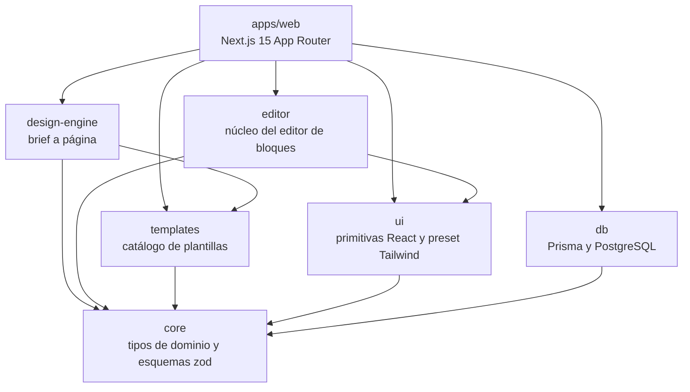
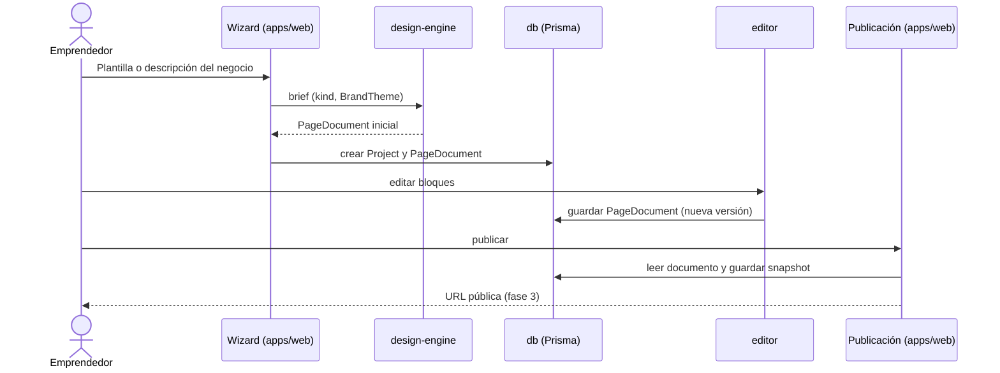
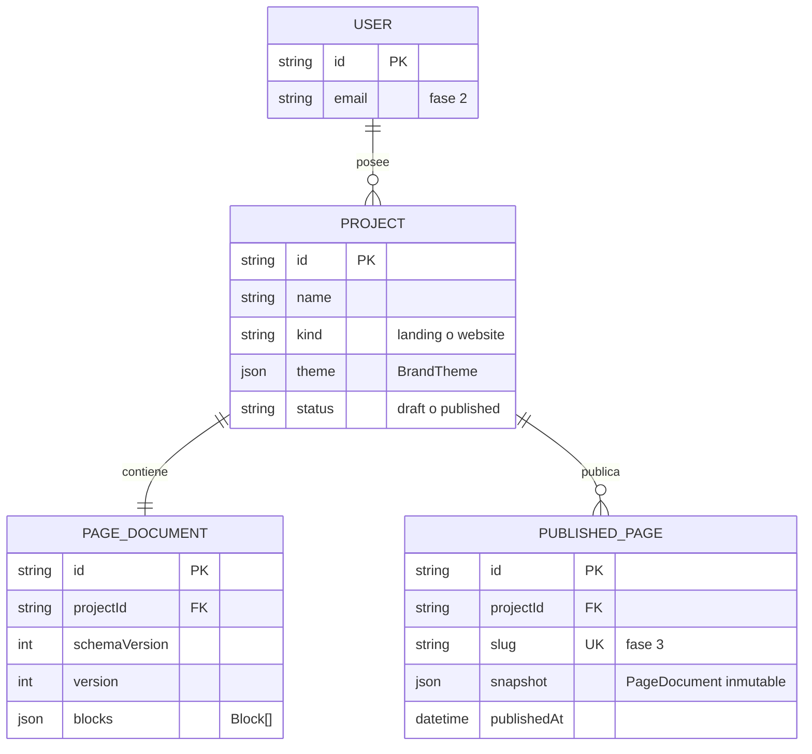

# Arquitectura de Clavonia

Clavonia ayuda a emprendedores a crear landing pages y sitios web de marca. El usuario elige una plantilla o describe su negocio, obtiene una página generada, la ajusta en un editor de bloques y la publica.

## Paquetes y dirección de dependencias

Las flechas van del paquete que depende hacia la dependencia.

Reglas:

- `core` no depende de ningún otro paquete `@clavonia/*`.
- Los paquetes de dominio (`templates`, `editor`, `design-engine`, `db`) nunca importan de `apps/web`.
- Sólo `apps/web` compone los paquetes: rutas, server actions, API y páginas.
- No hay ciclos entre paquetes.

## Flujo de peticiones

1. **Wizard.** El usuario elige una plantilla o describe su negocio en `apps/web`. Se crea un proyecto con `kind` (`landing` o `website`) y un `BrandTheme`.
2. **Motor de diseño.** `design-engine` recibe el brief y devuelve un `PageDocument` inicial. En la fase 1 usa un proveedor stub basado en plantillas; en la fase 4 se sustituye por un proveedor de IA detrás de la misma interfaz.
3. **Persistencia.** `apps/web` guarda el proyecto y su documento a través de `@clavonia/db`.
4. **Editor.** El usuario edita los bloques (`BLOCK_TYPES`) con operaciones de `@clavonia/editor`. Cada guardado persiste una nueva versión del documento.
5. **Publicación.** En la fase 3, `apps/web` crea un snapshot inmutable del documento, le asigna una URL pública y la sirve.

## Modelo de datos

El modelo es orientativo. La fuente de verdad es `packages/db/prisma/schema.prisma`.

Notas:

- `PAGE_DOCUMENT` guarda el documento actual del proyecto. Su formato se describe en el [ADR 0002](adr/0002-page-document-model.md).
- `USER` y el vínculo `owner` llegan en la fase 2. Hasta entonces los proyectos no tienen dueño.
- `PUBLISHED_PAGE` llega en la fase 3 y guarda snapshots que no cambian al editar el proyecto.
